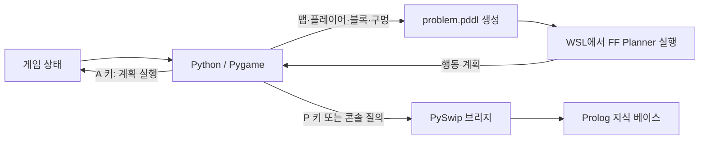

# Block Move

Block Move는 플레이어가 블록을 밀어 모든 구멍에 넣는 격자 퍼즐 게임입니다. 직접 플레이할 수 있고, 현재 맵을 PDDL 문제로 변환해 FF Planner가 만든 계획을 게임에서 자동으로 실행할 수 있습니다.

## 주요 기능

- 방향키로 플레이어를 이동하고 블록을 밀어 퍼즐을 풉니다.
- 무작위 맵을 생성합니다. 맵에는 벽·블록·구멍이 배치되며, 생성 단계에서 플레이어의 블록 접근 가능 여부와 블록의 막다른 칸 여부를 확인합니다.
- 현재 게임 상태를 PDDL 문제 파일로 만들고, FF Planner의 행동 계획을 파싱해 게임 이동으로 실행합니다.
- PySwip을 통해 현재 게임 상태를 Prolog 지식 베이스에 동기화하고 질의할 수 있습니다.
- Protege로 작성한 OWL 온톨로지와 Prolog 규칙 파일을 함께 제공합니다.

## 동작 구조



PDDL 도메인은 이동, 블록 밀기, 블록을 구멍에 넣는 행동의 전제 조건과 결과를 정의합니다. Prolog는 별도의 상태 동기화·질의 경로로 연결되어 있으며, 실제 키보드 이동 규칙은 Pygame 게임 코드에서 처리합니다. OWL 파일은 객체와 관계를 표현하는 모델 자료입니다.

## 실행 환경

- Windows
- Python 3.12
- WSL 및 기본 Linux 배포판
- SWI-Prolog (PySwip에서 사용할 수 있도록 설치)
- Python 패키지: Pygame 2.6.1, PySwip 0.3.3
- 저장소에 포함된 Linux용 FF 실행 파일: `Game/ff/ff`

## 실행 방법

저장소 루트에서 PowerShell을 열고 Python 패키지를 설치합니다.

```powershell
py -3.12 -m pip install pygame==2.6.1 pyswip==0.3.3
```

PySwip이 SWI-Prolog 실행 파일과 라이브러리를 찾을 수 있도록 SWI-Prolog를 먼저 설치하고 환경을 설정합니다.

WSL에서 FF 실행 파일에 실행 권한을 부여합니다. 저장소 루트에서 한 번 실행하면 됩니다.

```powershell
wsl chmod +x "$(wsl wslpath -a Game/ff/ff)"
```

게임을 실행합니다.

```powershell
py -3.12 Game/main.py
```

저장소에 포함된 Windows 가상환경을 사용하는 경우에는 `RunGame.bat`으로 실행할 수도 있습니다. 이 배치 파일은 `Game/venv/Scripts/python.exe` 경로를 사용합니다.

## 조작법

| 키 | 동작 |
| --- | --- |
| 방향키 | 플레이어 이동 및 블록 밀기 |
| A | FF Planner로 현재 맵을 풀고 계획 자동 실행 |
| P | 현재 상태를 Prolog에 동기화하고 기본 질의 예시 출력 |
| R | 새 맵 생성 |
| Esc | 게임 종료 |

실행 중인 콘솔에는 Prolog 질의를 입력할 수 있습니다. 예: `player(X, Y).`, `block(X, Y).`

## 프로젝트 구조

| 경로 | 설명 |
| --- | --- |
| `Game/main.py` | Pygame 실행 진입점 |
| `Game/game.py` | 맵 생성, 게임 규칙, 입력 처리와 화면 갱신 |
| `Game/agent.py` | PDDL 문제 생성, WSL에서 FF 실행, 계획 파싱 |
| `Game/domain.pddl` | 이동·밀기·구멍 넣기 행동 정의 |
| `Game/problem.pddl` | 샘플 맵의 PDDL 문제 |
| `Game/prolog_bridge.py` | Python과 Prolog 간 상태 동기화 및 질의 |
| `Ontology/game.pl` | 게임 상태와 규칙을 담은 Prolog 지식 베이스 |
| `Ontology/game.owl` | Protege로 작성한 OWL 온톨로지 |
| `RunGame.bat` | 저장소에 포함된 Windows 가상환경으로 실행 |

## 참고

- 무작위 생성 맵은 간단한 도달 가능성·막다른 칸 검사를 통과하지만, 모든 생성 맵의 해답을 보장하지는 않습니다. 해답이 없으면 자동 풀이가 `Impossible`을 출력합니다.
- FF 실행은 WSL의 기본 Linux 배포판을 사용합니다.
- 저장소에 포함된 가상환경과 FF 실행 파일은 OS·환경에 따라 동작이 달라질 수 있습니다.